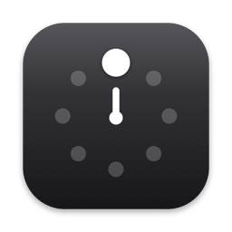
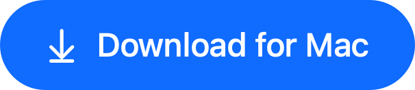
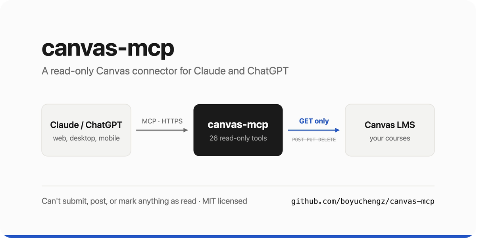
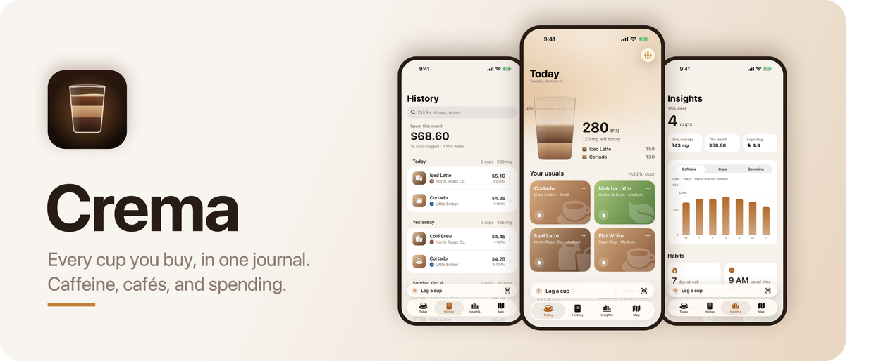
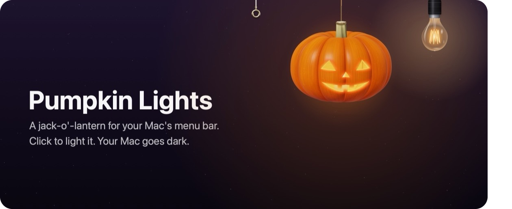

### Hi, I'm Boyucheng.

I design and make small, carefully finished software for the Mac and iPhone. Most of it started as something I wanted for myself.

无终止构建 · Building endlessly.

[boyucheng.me](https://boyucheng.me) · [Blog](https://boyucheng.me/blog) · [App Store](https://apps.apple.com/us/developer/id1588531242) · [X](https://x.com/robottoox) · [LinkedIn](https://www.linkedin.com/in/zbyc) · [hi@boyucheng.me](mailto:hi@boyucheng.me)

 

### [Optional](https://github.com/boyuchengz/optional)

**Option-Tab for everything.**

Hold Left Option, tap a letter, let go. Your clipboard, windows, recent files, headphones and the right action for what you've selected. One gesture, no typing.

Free&nbsp;&nbsp;·&nbsp;&nbsp;macOS 14 or later&nbsp;&nbsp;·&nbsp;&nbsp;Apple silicon

 

### canvas-mcp

Ask Claude or ChatGPT about your Canvas courses in plain language. 26 tools, and every one of them only reads: it can't submit, post, delete or mark anything as read.

**[Repository](https://github.com/boyuchengz/canvas-mcp)** · [Why read-only](https://boyucheng.me/blog/open-sourcing-canvas-mcp-a-read-only-canvas-connector)

 

### Crema

A coffee journal for iPhone. Log a cup in seconds and watch the day's caffeine fill up like a glass. No account, no ads.

**[Download on the App Store](https://apps.apple.com/us/app/crema-caffeine-cup-log/id6819921757)**

 

### Pumpkin Lights

A carved jack-o'-lantern, a bulb and a pull cord that hang from the menu bar and work as switches. Light the pumpkin and your Mac goes dark.

**[pumpkin.boyucheng.me](https://pumpkin.boyucheng.me)**

 

 

## Also

**[Banvas](https://boyuchengz.github.io/banvas/)** · A fast, clean Canvas client for iPhone. In internal testing.

**[Archer's Toolbox & Archer Guesser](https://apps.apple.com/us/developer/id1588531242)** · My first App Store releases, from high school.

**[More on my website!](https://boyucheng.me)**
